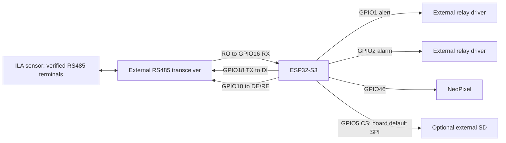
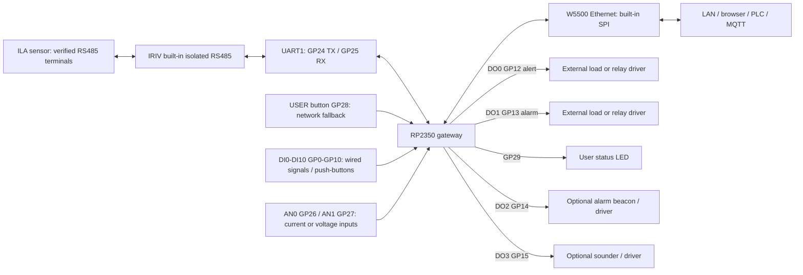

# Hardware wiring

Functional diagrams only. Confirm the exact ILA model and manufacturer manual before connecting sensor power or signal terminals. No connector pin numbers or cable colors are assumed.

## ESP32-S3

These explicit pins preserve the imported firmware. The chosen ESP32-S3 build variant defaults to SPI SCK12, MISO13 and MOSI11. Verify against your board; do not use the old README's SCK18 assignment because GPIO18 is RS485 TX. External relay drivers need suitable supply and protection; GPIOs are logic signals.

## Cytron IRIV IO Controller

Pins follow the Arduino-Pico `cytron_iriv_io_controller` board variant and the existing 883M IRIV implementation. The RS485 driver handles direction automatically; no DE/RE output is driven. DO0/DO1 are isolated digital outputs, not mechanical relay contacts. Follow the [manufacturer's board resources](https://my.cytron.io/p-iriv-io-controller) for terminal wiring, load limits and power. GPIO5 is a digital input on this board; SD logging is disabled. Ethernet owns the onboard SPI bus.

The I/O pages use DI0?DI10 at GP0?GP10, AN0/AN1 at GP26/GP27, and the spare DO2/DO3 at GP14/GP15, following the board variant. New channels and outputs are disabled until configured. Use the physical AN-IN switch to select Current for 4?20 mA or Voltage for 0?10 V. The onboard USER button retains its five-second network fallback action; wired isolated inputs can be assigned capture or acknowledge actions. See the [I/O setup guide](io-alarms.md). No analog output is provided.
