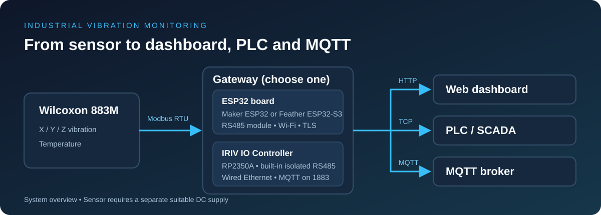
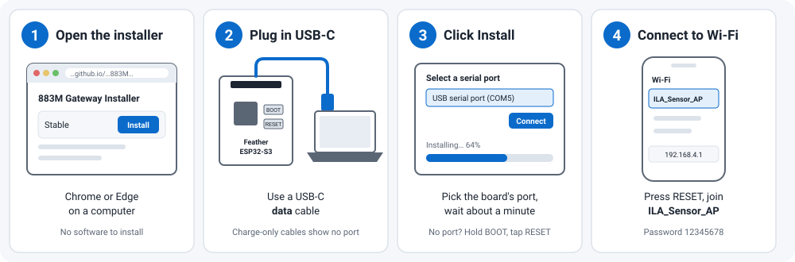
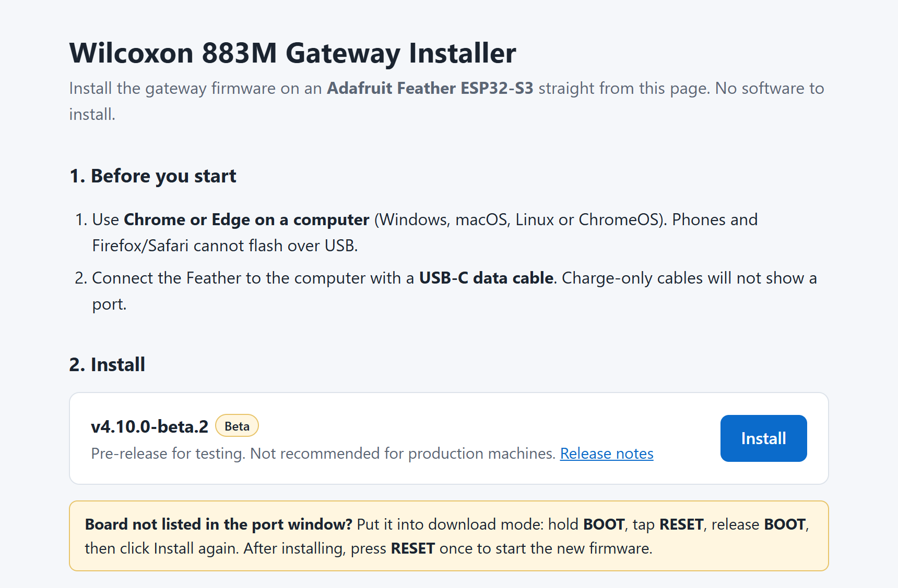
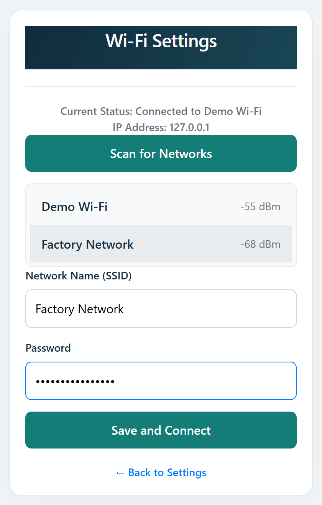
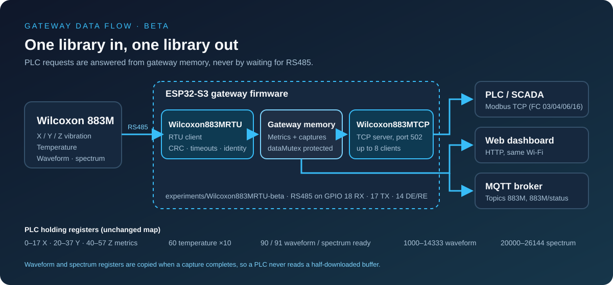
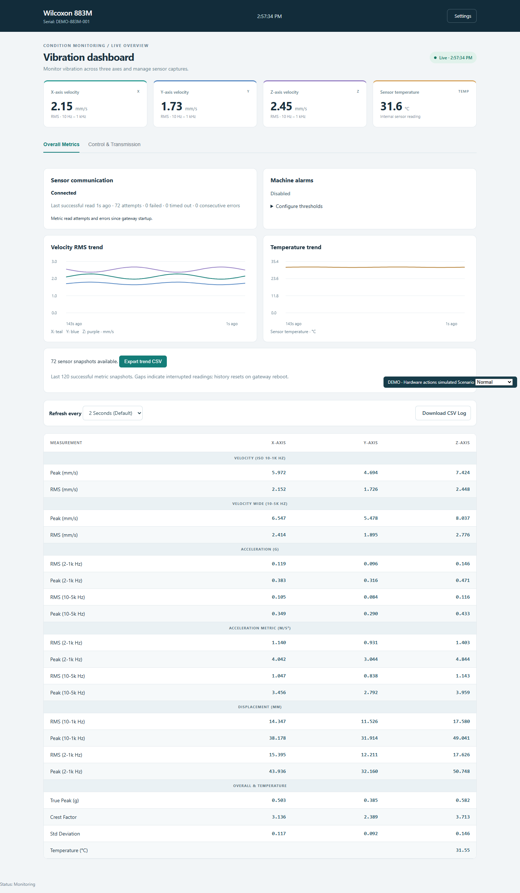
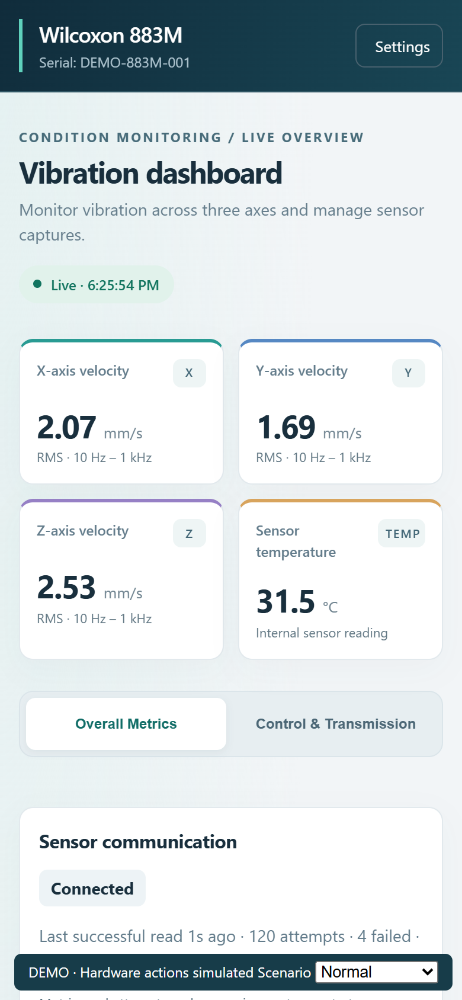
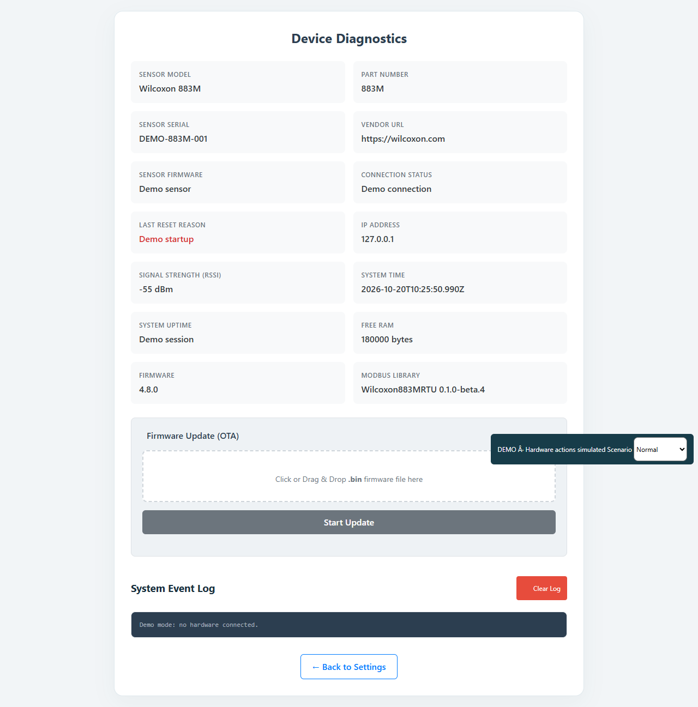
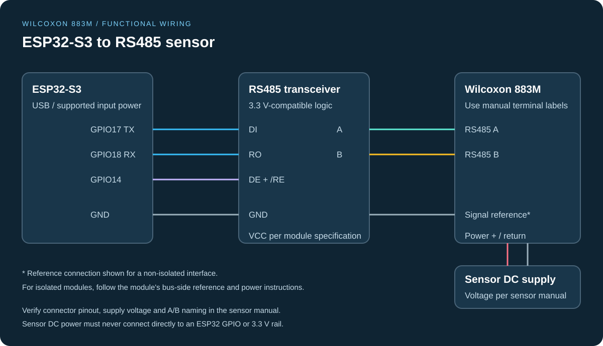
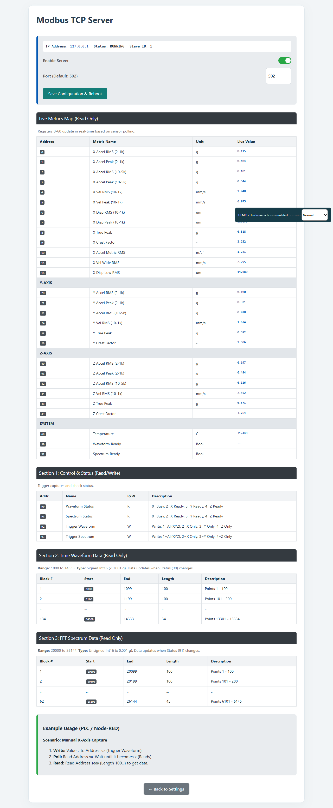

<div align="center">

# Wilcoxon 883M Industrial IoT Gateway

**Bring RS485 vibration data to your browser, PLC and MQTT broker.**

[](platformio.ini)
[](#modbus-tcp)
[](#mqtt)
[](LICENSE)

[](https://dineshpalsingh1989.github.io/Wilcoxon-883M_RTU-to-TCP-and-MQTT/)

[Install](#install-on-your-esp32-in-4-steps) · [Quick start](#quick-start) · [Dashboard preview](#dashboard-preview) · [Wiring](#hardware-and-wiring) · [MQTT](#mqtt) · [Firmware updates](#firmware-updates)

</div>



Firmware for an ESP32-S3 gateway connected to a **Wilcoxon 883M vibration sensor** through an RS485-to-TTL interface. Monitor machine vibration and temperature, capture waveforms and FFT spectra, and share readings over Wi-Fi.

## Install on your ESP32 in 4 steps

**You can put this gateway on your own ESP32 board straight from your browser.** No PlatformIO, Arduino IDE or library downloads: the firmware already contains everything, including the Wilcoxon883MRTU Modbus RTU/TCP library.

| You need | |
| --- | --- |
| ESP32 board | **Adafruit Feather ESP32-S3** (the board this firmware is built and pinned for) |
| Cable | USB-C **data** cable |
| Computer | Chrome or Edge on Windows, macOS, Linux or ChromeOS |
| Sensor wiring (afterwards) | RS485-to-TTL module and Wilcoxon 883M, see [Hardware and wiring](#hardware-and-wiring) |

> **Other ESP32 boards:** the installer only offers the Feather ESP32-S3 build. Other ESP32-S3 boards use different pins, flash layouts and USB setups, so the image may not start or may drive the wrong pins. Build from source for another board after checking [`src/config/config.h`](src/config/config.h) against your wiring.

<p align="center"><a href="https://dineshpalsingh1989.github.io/Wilcoxon-883M_RTU-to-TCP-and-MQTT/"><strong>➜ Open the web installer</strong></a></p>



1. **Open the [web installer](https://dineshpalsingh1989.github.io/Wilcoxon-883M_RTU-to-TCP-and-MQTT/)** in Chrome or Edge on a computer.
2. **Plug the board in** with a USB-C data cable.
3. **Click Install** and pick the board's port. It takes about a minute. If no port appears, hold **BOOT**, tap **RESET**, release **BOOT** and try again.
4. **Press RESET**, join the Wi-Fi network **`ILA_Sensor_AP`** (password `12345678`), open **http://192.168.4.1** and enter your own Wi-Fi under **Settings > Wi-Fi**.

<table>
<tr>
<td width="60%"></td>
<td width="40%"></td>
</tr>
<tr>
<td><em>Step 3: the web installer. The version shown is an example; the page lists the current releases.</em></td>
<td><em>Step 4: Wi-Fi Settings on the gateway (simulated demo).</em></td>
</tr>
</table>

After saving, the gateway restarts and joins your network. Open its new IP address to see the dashboard, then [wire the sensor](#hardware-and-wiring).

### If the install does not work

Re-installing is always safe: the ESP32-S3's built-in loader cannot be erased, so you can simply try again.

| Problem | Fix |
| --- | --- |
| No port appears | Use a USB-C **data** cable, try another USB socket (no hub), then hold **BOOT**, tap **RESET**, release **BOOT** and try again |
| "Failed to connect" or timeout | Close Arduino IDE, PlatformIO or any serial monitor using the port, then use BOOT + RESET as above |
| Stops halfway | Change the cable, avoid hubs and install again |
| Finished but nothing happens | Press **RESET**. Still no `ILA_Sensor_AP`? Install again with *Erase device* ticked |
| Browser not supported | Use Chrome or Edge on a computer, or one of the other ways below |

**Other ways to install the same firmware:**

| Way | Use when |
| --- | --- |
| [Espressif browser flasher](docs/installing-firmware.md#2-espressif-browser-flasher): write `factory-adafruit_feather_esp32s3.bin` at `0x0` | The installer page fails but Chrome or Edge works |
| [esptool command line](docs/installing-firmware.md#3-esptool-command-line): `python -m esptool --chip esp32s3 write_flash 0x0 factory-adafruit_feather_esp32s3.bin` | Any computer with Python, no browser needed |
| [Espressif Flash Download Tool](docs/installing-firmware.md#4-espressif-flash-download-tool-windows) | Windows users who prefer a desktop app |
| [Build from source](#build-and-flash-the-gateway) with PlatformIO | Developers |

The factory file is on each [release](https://github.com/dineshpalsingh1989/Wilcoxon-883M_RTU-to-TCP-and-MQTT/releases) and clears saved settings. The [installation guide](docs/installing-firmware.md) has step-by-step instructions for each way.

## Beta: built on our own Modbus library

> **Beta firmware.** The `main` branch now uses this project's own **Wilcoxon883MRTU 0.1.0-beta.4** library for both sides of the gateway. The third-party `ModbusMaster` and `modbus-esp8266` libraries are no longer used. Register addresses, MQTT messages and web pages are unchanged. Simulated tests and the ESP32-S3 build pass; **it has not yet been validated with a real 883M sensor or PLC.** Use the latest stable release for production and the beta on a bench gateway.



| Part | Job | Replaces |
| --- | --- | --- |
| `Wilcoxon883MRTU` | Reads the sensor over RS485: metrics, captures, device identity | `ModbusMaster` |
| `Wilcoxon883MTCP` | Serves the gateway's registers to PLCs/SCADA over Wi-Fi | `modbus-esp8266` |

The library lives in [experiments/Wilcoxon883MRTU-beta](experiments/Wilcoxon883MRTU-beta/README.md) and is compiled into the firmware from this repository, so a gateway firmware update always brings the matching library version. **Settings > Device Diagnostics** shows which version is installed. The library can also be used on its own in Arduino or PlatformIO sketches; see its [installation guide](experiments/Wilcoxon883MRTU-beta/README.md). The [library migration guide](docs/modbus-library.md) covers compatibility, memory use, the beta release process and the bench tests still needed.

## What you can do

| Feature | What it provides |
| --- | --- |
| Browser dashboard | Live X/Y/Z metrics, velocity and temperature trends, and waveform/spectrum charts |
| Sensor health | Connection status, failed reads, timeouts and age of the last successful reading |
| Configurable alarms | Velocity RMS and temperature thresholds with a configurable delay |
| Capture tools | Single-axis or XYZ captures, capture history and CSV export |
| MQTT integration | Scalar metrics, chunked waveform/spectrum data, health status and remote commands |
| Modbus TCP server | Cached measurements and capture buffers for up to 8 PLC and SCADA clients |
| Gateway management | Wi-Fi, RS485, MQTT and time settings, plus GitHub firmware installation |

## Dashboard preview



*Actual dashboard rendered by the hardware-free demo with simulated readings. Values shown are illustrative.*

<table>
<tr>
<td width="30%"></td>
<td width="70%"></td>
</tr>
<tr>
<td><em>Mobile layout (simulated).</em></td>
<td><em>Device Diagnostics shows the installed Modbus library version (simulated).</em></td>
</tr>
</table>

## Quick start

### Downloads

Most users only need the [web installer](#install-on-your-esp32-in-4-steps).

| Download | For | Where |
| --- | --- | --- |
| Gateway firmware, new board | First install or recovery | [Web installer](https://dineshpalsingh1989.github.io/Wilcoxon-883M_RTU-to-TCP-and-MQTT/), or `factory-adafruit_feather_esp32s3.bin` at `0x0` from the [releases](https://github.com/dineshpalsingh1989/Wilcoxon-883M_RTU-to-TCP-and-MQTT/releases) |
| Gateway firmware, update | A gateway that already runs this firmware | **Settings > GitHub Firmware Updates**, or `firmware-adafruit_feather_esp32s3.bin` on the [latest release](https://github.com/dineshpalsingh1989/Wilcoxon-883M_RTU-to-TCP-and-MQTT/releases/latest) |
| Wilcoxon883MRTU library | Using the Modbus RTU/TCP library in your own sketch | `Wilcoxon883MRTU-<version>.zip` on the newest `wilcoxon883mrtu-v*` [release](https://github.com/dineshpalsingh1989/Wilcoxon-883M_RTU-to-TCP-and-MQTT/releases); in Arduino IDE use **Sketch > Include Library > Add .ZIP Library** |

### Try it without hardware

Install Node.js, then run:

```sh
git clone https://github.com/dineshpalsingh1989/Wilcoxon-883M_RTU-to-TCP-and-MQTT.git
cd Wilcoxon-883M_RTU-to-TCP-and-MQTT
node demo/mock_server.js
```

Open **http://localhost:8080**. Use the demo scenario selector to explore normal operation, high vibration and an offline sensor. Settings and firmware update actions are simulated. See the [demo guide](demo/README.md) for details.

### Build and flash the gateway

1. Install PlatformIO and open this repository in VS Code.
2. Check the board and pin assignments below against your hardware.
3. Connect the ESP32-S3 over USB and run:

```sh
pio run
pio run --target upload
pio device monitor
```

The configured environment is `adafruit_feather_esp32s3`, using the Arduino framework. PlatformIO installs the libraries declared in [platformio.ini](platformio.ini). The build helper also requires Python's `certifi` package in the PlatformIO Python environment.

### Connect to Wi-Fi

1. Connect to the gateway access point **`ILA_Sensor_AP`**, password **`12345678`**.
2. Open **http://192.168.4.1**.
3. Open **Settings > Wi-Fi** and save your network credentials.
4. Open the gateway's assigned local IP address to use the dashboard.

## Hardware and wiring



Follow the [step-by-step wiring and troubleshooting guide](docs/wiring.md) before powering the hardware.

| Component | Purpose |
| --- | --- |
| ESP32-S3 board | Gateway; project hardware targets the Cytron Maker Feather AIoT S3 |
| Wilcoxon 883M | RS485 Modbus RTU vibration and temperature sensor |
| RS485-to-TTL UART module | Interface with ESP32-compatible 3.3 V logic levels |
| Suitable DC supply | Sensor power; check the linked sensor manual for supply and wiring requirements |

**Current firmware assignments** from [src/config/config.h](src/config/config.h):

| ESP32 GPIO | Connection / function |
| --- | --- |
| 18 | RS485 module RO → UART RX |
| 17 | UART TX → RS485 module DI |
| 14 | RS485 module DE and RE direction control |
| 5 | Buzzer |
| 0 | User button |
| 48 | RGB status LED |

Connect the sensor's RS485 pair to the module's A/B terminals according to the hardware documentation. Confirm grounding and termination for your installation. Board labels can differ from GPIO numbers; verify the selected board before applying power.

[Wilcoxon 883M user manual (PDF)](883M-User-Manual-Rev.1.0_20241206-EN.pdf)

## MQTT

The default base topic is **`883M`**, configurable in Settings. TLS is supported.

| Topic | Direction | Content |
| --- | --- | --- |
| `883M` | Gateway → broker | Metrics, waveform chunks and spectrum chunks |
| `883M/status` | Gateway → broker | Health status, normally every five minutes |
| `883M/command` | Broker → gateway | Commands addressed to the sensor serial number |

Every command must include a **`serial_number` matching the connected sensor**.

```json
{
  "serial_number": "ENTER_DEVICE_SERIAL_HERE",
  "command": "trigger_capture",
  "axis": "X"
}
```

| Command | Additional fields | Action |
| --- | --- | --- |
| `trigger_capture` | `"axis": "X"`, `"Y"` or `"Z"` | Capture waveform and spectrum for one axis |
| `trigger_all` | None | Start an XYZ capture sequence |
| `get_metrics` | None | Publish scalar metrics immediately |
| `set_interval` | `"interval_ms": 600000` | Set the automatic capture interval; example is 10 minutes |
| `reboot` | None | Restart the gateway |

Set `interval_ms` to `2147483647` to use the firmware's disabled auto-capture interval. Captures are refused while another capture or firmware update is active.

Waveform and spectrum messages use `type`, `axis`, `capture_id`, `chunk_index`, `total_chunks` and `data`. Reassemble chunks in index order for each capture and axis. Chunks carry up to **200 points**: 67 chunks for a 13,334-point waveform and 31 for a 6,145-point spectrum.

For plots, waveform values represent acceleration in g; time depends on the sample interval. Spectrum values represent amplitude in g; frequency is the bin index multiplied by the firmware's frequency resolution (`13333.333 / 16384` Hz). Timestamps use configured local time and do not carry a UTC `Z` suffix.

## Modbus TCP

The gateway serves cached data on the configured Modbus TCP port, normally **502**. Values are **holding registers**, using zero-based addresses. Divide raw values by the scale below to obtain engineering units.

| Address | Measurement | Scale | Unit |
| --- | --- | --- | --- |
| 0 | X acceleration RMS | 100 | g |
| 1 | X acceleration peak | 100 | g |
| 2 | X acceleration RMS, 10–5k Hz | 100 | g |
| 3 | X acceleration peak, 10–5k Hz | 100 | g |
| 4 | X velocity RMS | 10 | mm/s |
| 5 | X velocity peak | 10 | mm/s |
| 6 | X displacement RMS* | 1 | µm |
| 7 | X displacement peak | 1 | µm |
| 8 | X true peak | 100 | g |
| 9 | X crest factor | 100 | — |
| 20–37 | Y metrics, same layout as X addresses 0–17 | Varies | Varies |
| 40–57 | Z metrics, same layout as X addresses 0–17 | Varies | Varies |
| 60 | Temperature | 10 | °C |
| 1000–14333 | Latest-axis waveform, signed Int16 | 1000 | g |
| 20000–26144 | Latest-axis spectrum, UInt16 | 1000 | g |

| 90 | Waveform ready: 2 = X, 3 = Y, 4 = Z, 0 = cleared | — | — |
| 91 | Spectrum ready: same values as 90 | — | — |

*Displacement RMS is not currently read from the sensor. See [the register cache implementation](src/modbus/modbus_tcp.cpp) and [register constants](src/config/config.h) for the complete mapping.*

Server behaviour: function codes 03, 04, 06 and 16, up to **8 clients**, any unit ID, up to 125 registers per read. Registers 0–99 accept writes, but the next sensor update overwrites them. Waveform and spectrum registers are read-only and are copied from a finished capture, so a PLC never reads a buffer that is still downloading. A read that spans an unmapped gap (for example 95–105) returns an illegal-address exception. Modbus TCP has no authentication; keep port 502 on a trusted network.



*Settings > Modbus TCP lists the register map with live values (simulated here).*

> **Known gap:** that page describes **92/93 as capture triggers** for PLCs, but the firmware does not act on writes to them yet. Start captures from the dashboard or with the MQTT `trigger_capture` / `trigger_all` commands for now.

## Firmware updates

Open **Settings > GitHub Firmware Updates** to check for a newer stable release and install it on the **ESP32 gateway**.

The updater requires a stable `vMAJOR.MINOR.PATCH` release, the asset `firmware-adafruit_feather_esp32s3.bin`, and GitHub's SHA-256 asset digest. It validates HTTPS certificates, image compatibility, partition size and the downloaded checksum before activating the image and rebooting. Wi-Fi and a correct gateway clock are required.

See the [update guide](demo/README.md#github-firmware-installation) for release publishing and validation details. Updates apply to the gateway; they do not update the Wilcoxon sensor firmware.

**Beta releases** use tags such as `v4.10.0-beta.1`. They are published as GitHub **pre-releases**, never marked Latest, so the gateway's updater does not offer them. To try a beta, download `firmware-adafruit_feather_esp32s3.bin` from the pre-release and upload it under **Settings > Device Diagnostics > Firmware Update (OTA)** or with PlatformIO. A gateway running a beta can later move to the matching stable release (for example `v4.10.0`) through the normal updater.

## Watchdog protection

The background task configures the ESP32 task watchdog for 60 seconds with panic handling and explicitly subscribes itself. It feeds the watchdog in its main loop and during sensor block reads and MQTT chunk publishing. This is intended to recover from a subscribed task that stops servicing the watchdog.

The web task is not explicitly subscribed, and initialization/subscription return values are currently unchecked. Full task coverage and recovery must be verified on the actual board, including healthy long captures and firmware updates. Source: [task setup](src/tasks/tasks.cpp).

## Operational notes

- Trend history (120 successful snapshots) and capture history (20 results) are stored in RAM and reset on reboot. Alarm settings persist on the real gateway.
- Dashboard alarms are disabled until configured. They do not control machinery or the buzzer; choose limits appropriate to the machine.
- Web and OTA endpoints currently have no authentication. Deploy the gateway on a trusted network.
- Firmware integrity checks do not provide signature verification or application-health rollback. Actual sensor operation and flash updates still require validation on the target hardware.

## Project layout

| Location | Contents |
| --- | --- |
| `src/config/`, `src/core/` | Pin/register definitions, shared state and monitoring |
| `src/modbus/` | Sensor RTU communication and TCP register cache |
| `experiments/Wilcoxon883MRTU-beta/` | Our Modbus RTU client and TCP server library, used by the firmware |
| `src/capture/`, `src/mqtt/` | Capture state machine, logs, publishers and commands |
| `src/web/` | Dashboard, settings pages and HTTP routes |
| `src/ota/` | Firmware upload and GitHub release installation |
| `src/hardware/`, `src/tasks/`, `src/utils/` | Hardware helpers, FreeRTOS tasks and utilities |
| `demo/` | Hardware-free preview and browser checks |
| `installer/` | Browser installer page published to GitHub Pages |
| `scripts/` | Build configuration, web installer bundle and site helpers |

## License

Released under the [MIT License](LICENSE).
